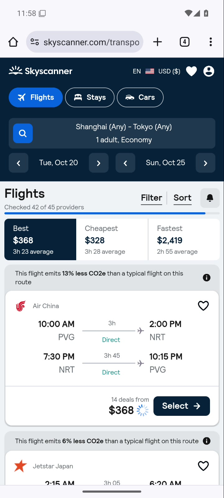

# Android 查机票实录

[English](README.md) | **简体中文**

[观看／下载完整录像](https://github.com/Olorinm/mobile-mcp-jev/raw/refs/heads/main/docs/demos/skyscanner-2026-09-18.mp4) · [脱敏测量记录](skyscanner-2026-09-18.json) · [对应执行器代码](https://github.com/Olorinm/mobile-mcp-jev/commit/1f0b2d5573059af97439dd9149d32f7d52fdba66)

录制于 2026 年 9 月 18 日。Jev 在 Android Chrome 中操作天巡网站，最终显示上海所有机场至东京所有机场、10 月 20–25 日往返、1 成人、经济舱及实际航班列表。日历选择记录确认年份为 2026。部分供应商仍在刷新报价；目标要求展示航班结果，不要求所有供应商都搜索完毕。没有订票或支付。

| 测量项 | 本次录屏重跑 |
|---|---:|
| 执行器总耗时 | 70.225 秒 |
| 已执行操作，含一次等待 | 18 次 |
| Jev 判断 | 21 次 |
| DeepSeek 生成输入文字 | 1 次 |
| 接口报告的 API 总费用 | $0.01125449 |
| 输入／输出 Token | 259,148 / 18,426 |
| 读取、校验设备状态 | 43.064 秒 |
| 模型请求 | 19.971 秒 |
| 设备操作 | 6.677 秒 |
| 显式等待 | 0.359 秒 |

录像约 73.35 秒，包含任务前后的手机画面。全程连续、原速、无剪切，没有声音或电脑桌面内容。发布的 MP4 保留原始 H.264 视频流，只移除了辅助数据流和元数据。录屏和面板实时截图可能影响性能。

## 条件与局限

- 计时前已经打开首页、选好上海所有机场；目的地和日期为空，1 成人和经济舱已选。保留了此前测试的浏览器状态和缓存。
- Android 15/API 35 模拟器，软件渲染，设备画面 1080×2400，录像 720×1600。使用带[本地缓存补丁](../../patches/mobilecli/README.md)的 MobileCLI 1.0.9，以及本项目的 Chrome 后备读取通道。
- 沿用前一次 76.40 秒未录屏验证的执行器和目标。这是此次重跑唯一一次录制尝试，不是开发期间第一次尝试。此前开发失败记录没有计入这两次单次耗时。
- 面板直接运行 `typesafe-ai/jev`；`deepseek/deepseek-v4.1-flash` 仅生成输入文字 `Tokyo`，请求关闭推理。本次没有外层 OpenCode、视觉模型接管、中途人工操作或针对该任务的日期纠错代码。
- 现有通用提示词、已选标签过滤、重复状态／动作选项过滤及步数／时间限制均保持启用。本录像展示当前执行器，不能视为隔离其他因素的纯模型测试。上限为 40 个决策步骤、300 秒。
- Jev 最初将返程选成 10 月 24 日，随后重新打开日历，最终选中 25 日。绕路过程完整保留。航班列表变化时，另有两次决策被丢弃并重新判断。
- 执行器返回 `reported_complete`，原始 `verified` 仍为 false。最后另行查看屏幕，核对城市、日期、人数、舱位及航班卡片；核验没有改变手机状态，也未计入任务耗时。
- 费用为 Gateway 报告的本次调用总和，用量字段完整；不含硬件、电力和录屏成本。未重跑基线，不能由此推导相对其他 Agent 的速度或成本优势。

## 复现

配置[调试面板](../../README.zh-CN.md#可视化调试)，恢复相同起点，使用[英文说明中的原始任务](README.md#task-supplied-to-the-executor)自动运行。票价、余票、页面结构及网络时延都可能变化。

公开 JSON 只保留允许发布的测量字段和动作描述，排除了原始设备／会话标识、模型请求标识、密钥和本机路径。测试手机未登录个人账号。
